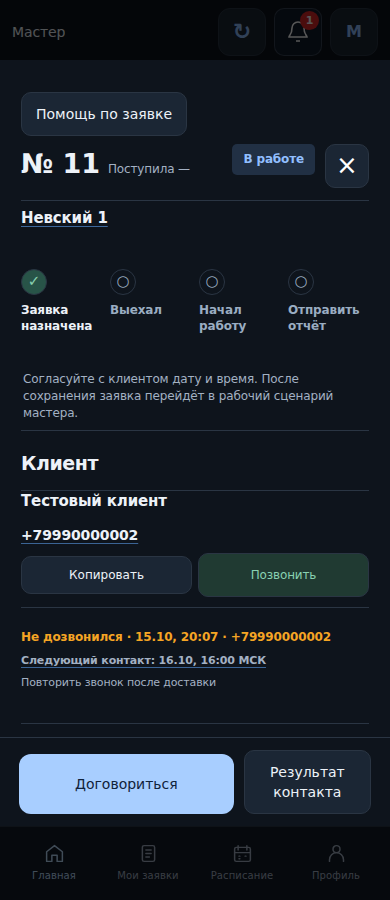
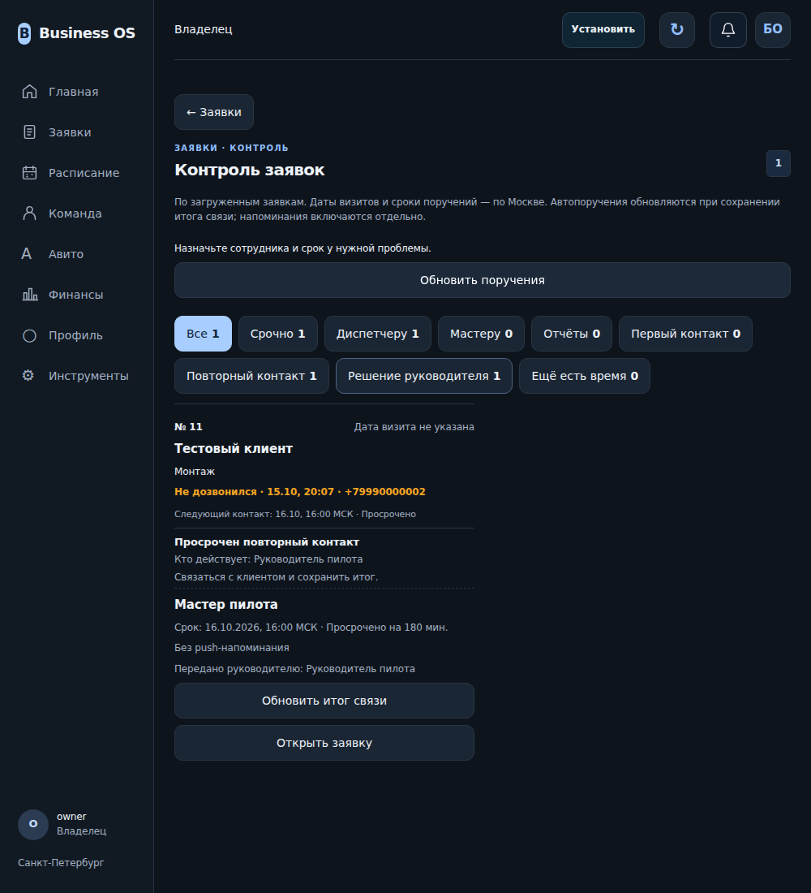
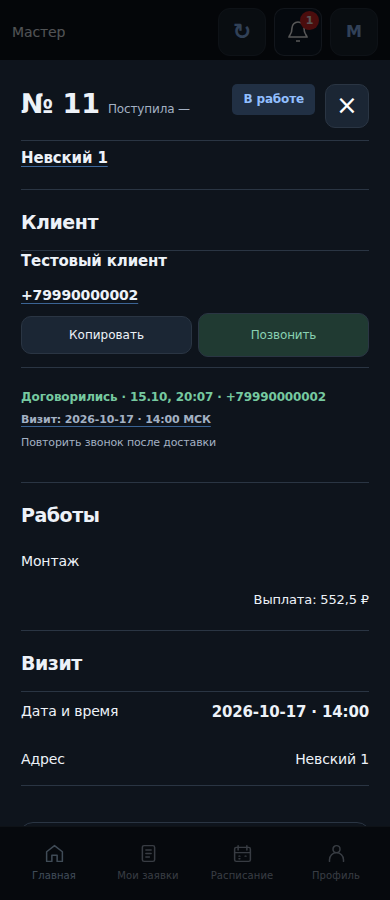

# Три сценария на fixture-данных

Изображения сняты Playwright в существующем приложении. Внешняя сеть блокируется, API отвечает синтетическими данными. Это визуальная проверка интерфейса, не hosted Preview и не production. Серверная транзакция, timer и sender отдельно проверяются SQL-контрактами.

1. Мастер сохранил «Не дозвонился» и конкретный следующий контакт. Дата визита не подставлена.

2. Срок прошёл, запись доступна в существующем Контроле, показаны просрочка и ответственный руководитель.

3. Мастер сохранил «Договорились» с визитом. Тест проверяет отсутствие прежнего contact-поручения в Контроле после сохранения.

Воспроизведение: `BOS_CONTACT_CAPTURE_DIR=docs/contact-control/preview npx playwright test tests/contact-control-demo.spec.js --workers=1`.
